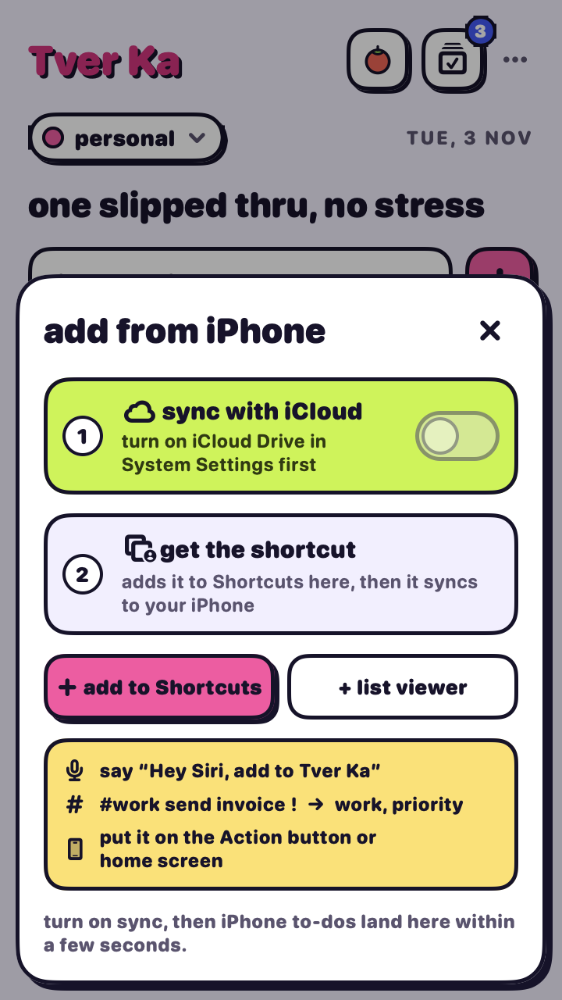
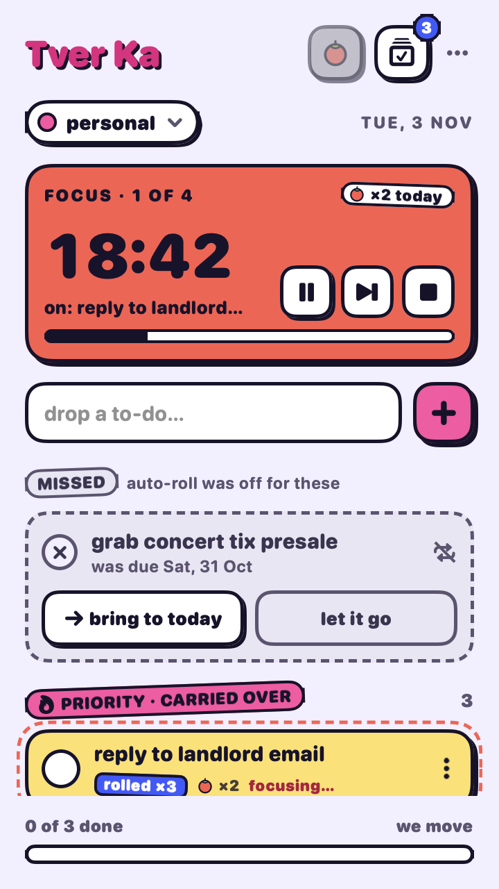
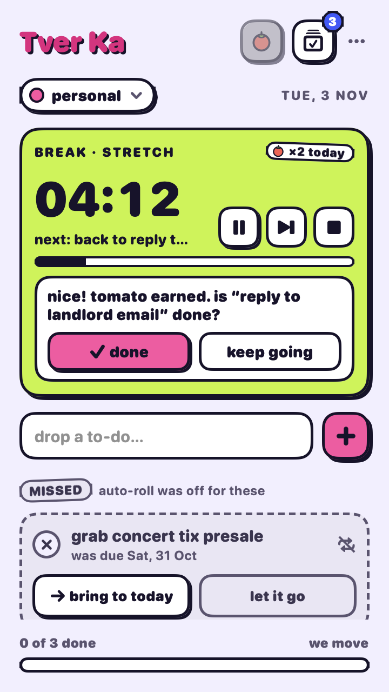
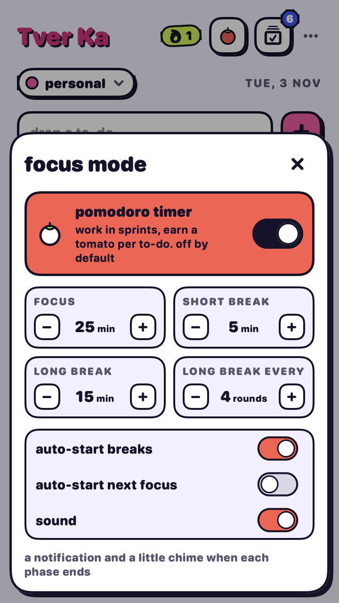

<p align="center">
  
</p>

<h1 align="center">Tver Ka</h1>

<p align="center">
  <b>A playful menu bar to-do app for macOS where unfinished tasks don't disappear. They roll over to tomorrow and get louder.</b>
</p>

<p align="center">
  
  
  
  
</p>

<p align="center">
  
  &nbsp;&nbsp;
  
</p>

---

## Why

Most to-do apps let yesterday's unfinished tasks quietly pile up somewhere you never look. Tver Ka works differently:

> If a to-do isn't done by midnight, it **slides to the next day** and gets a 🔥 **priority** sticker, with a counter showing how many days it's been carried over (`rolled ×3`).

You can't ignore it, but you can turn it off for any single task. Those tasks stay on their day and show up as **missed**, so you decide to bring them back or let them go.

## Features

- **Auto-roll.** Unfinished to-dos move to today, jump to the top as priority, and count every skipped day, even if your Mac was asleep or the app was closed.
- **Per-task control.** Switch auto-roll off for a to-do and it becomes *missed* instead, with "bring to today" and "let it go" buttons.
- **Projects.** Keep separate lists (work, uni, personal…), each with its own color. Switch with a dropdown, or pick **all projects** to work through everything in one list. There, a picker in the add field chooses which project new to-dos go to.
- **Typing shortcuts.** In the add field, `#work send invoice` files it under *work* and a trailing `!` makes it priority. It's the same syntax as the iPhone Shortcut.
- **The done pile.** Finished to-dos stay out of the way behind one small button, grouped by day, and each one can be undone.
- **Streaks.** The streak counts the days in a row you've finished at least one to-do.
- **Menu bar icon.** A full-color mascot that's easy to spot, with your open count. A yellow dot means priority to-dos are waiting.
- **Focus mode (optional).** A built-in Pomodoro timer: start a focus session on any to-do, earn a 🍅 per session, and see the countdown right in the menu bar. It's off until you turn it on. [More below](#focus-mode-pomodoro).
- **Add from your iPhone.** Turn on iCloud sync and use the included Shortcut: "Hey Siri, add to Tver Ka", the Action button, or a home screen icon. To-dos land on your Mac within seconds.
- **Light, dark, or match system.**
- **Updates itself.** Checks GitHub daily, then installs signed updates in place with one click, so you never end up with two copies.
- **Native and private.** SwiftUI, no account, no server. Your data is a single JSON file, kept on your Mac or in your own iCloud Drive.

<p align="center">
  
  
  
</p>
<p align="center">
  
  
</p>
<p align="center">
  
  <br>
  
</p>

## Install

### Download (easiest)

1. Grab **`Tver-Ka-<version>.zip`** from the [latest release](https://github.com/JBeanny/tver-ka-app/releases/latest). It's one universal build for Apple Silicon and Intel Macs, and needs macOS 14 Sonoma or later.
2. Unzip it and drag **Tver Ka.app** into **Applications**.
3. Open it. The first time, macOS will say it can't verify the developer. That's expected: Tver Ka is a free hobby project and isn't notarized with a paid Apple Developer account. To allow it once:
   - open **System Settings › Privacy & Security**, scroll down, and click **Open Anyway** next to Tver Ka, **or**
   - run `xattr -dr com.apple.quarantine "/Applications/Tver Ka.app"` in Terminal.

   After that it opens normally. If you'd rather not trust a prebuilt binary, build it yourself (below). It's the same code.

### Build from source

**Requirements:** macOS 14 Sonoma or later, plus Xcode 16 or later (or the matching Command Line Tools with Swift 6).

```sh
git clone https://github.com/JBeanny/tver-ka-app.git
cd tver-ka-app
Scripts/bundle.sh --install      # builds and copies "Tver Ka.app" to /Applications
open "/Applications/Tver Ka.app"
```

The app lives only in the menu bar (no Dock icon). Look for the pink blob in sunglasses. If you use a menu bar manager or have a notch, it may start out in the hidden section, so drag it out once.

To start it automatically, open the popover and choose **`…` › Launch at login**.

**Updating:** Tver Ka updates itself. It checks GitHub once a day (switch that off in the update sheet), puts a pink dot on the **`…`** button when a new version is out, and **`…` › Update to x.y.z…** downloads it, **checks its signature** (every release is signed, and unsigned or tampered downloads are refused), and **replaces the app in place**, so you never end up with two copies. Your to-dos aren't touched. You can also check any time with **`…` › Check for Updates…**.

> Coming from an older build called **tver-ka**? Install Tver Ka 1.2 or later any way you like. On first launch it moves the old `tver-ka.app` to the Trash and quits it if it's running. Your data, iCloud sync and iPhone Shortcut carry over, because the folders behind them keep their names.

If you built from source, pull and run the install again:

```sh
git pull && pkill -f TverKa; Scripts/bundle.sh --install && open "/Applications/Tver Ka.app"
```

## iPhone & iCloud

Tver Ka syncs through **your own iCloud Drive**. There's no server and no extra account, and no iPhone app to install. Adding from the phone uses Apple's **Shortcuts** app.

<p align="center"></p>

**Set it up (once):**
1. In the menu bar popover, open **`…` › Add from iPhone…**
2. Turn on **sync with iCloud**. Your to-dos move to `iCloud Drive › tver-ka › todos.json`, and a backup of the local copy is kept.
3. Click **add to Shortcuts**. The "Add to Tver Ka" shortcut is added on your Mac and syncs to your iPhone through iCloud. (Optional: **+ list viewer** adds "My Tver Ka to-dos", which shows today's list on the phone.)

**Use it on iPhone:** run **Add to Tver Ka** from Siri ("Hey Siri, add to Tver Ka"), the Action button, a home screen icon, or the Shortcuts widget. Type or say the to-do and it appears on your Mac within about 5 seconds.

| You type | Result |
| --- | --- |
| `buy oat milk` | to-do in the project you last used |
| `#work send invoice` | goes into the **work** project (case-insensitive) |
| `call landlord !` | marked **priority** |

**How it works:** the shortcut saves each to-do as a tiny text file in `iCloud Drive › Shortcuts › tver-ka › inbox`. The Mac app checks that folder every few seconds, adds what it finds, and deletes the files. It also keeps `iCloud Drive › Shortcuts › tver-ka › Today.md` up to date, so you can read your list in the Files app or with the list-viewer shortcut.

<details>
<summary><b>Build the shortcut by hand instead</b> (if the import doesn't work)</summary>

In the Shortcuts app on iPhone, tap **+** and add:

1. **Ask for Input** → type *Text*, prompt `what's the move?`
2. **Save File** → input *Provided Input*, turn **Ask Where to Save** off, and set the destination path to `tver-ka/inbox/` + the **Current Date** variable (custom format `yyyyMMdd-HHmmss-SSS`) + `.txt`

Name it **Add to Tver Ka**.
</details>

> **Good to know:** iCloud Drive sync is "last write wins". If two Macs edit at the exact same moment, one edit can be lost; iCloud keeps a conflict copy next to the file. For a single Mac plus an iPhone this doesn't come up.
>
> A full native iPhone app with live two-way sync (CloudKit) is possible later, but it needs a paid Apple Developer account.

## Focus mode (Pomodoro)

<p align="center">
  
  
  
</p>

The [Pomodoro Technique](https://en.wikipedia.org/wiki/Pomodoro_Technique), built into your to-dos: work in short focused sprints with breaks in between, and see where your effort actually went. It's **optional and off by default**, so if you don't want it, nothing changes.

**Turn it on:** **`…` › Focus mode (pomodoro)**. The first time, macOS asks whether Tver Ka can send notifications.

**How a session goes:**
1. **Start.** Tap the 🍅▶ button on any to-do row to focus on that task, or the tomato in the header for a free session with no task.
2. **Focus.** A red card replaces the greeting, with a big countdown, the task you're on, a progress bar, and pause / skip / stop. The task gets a dashed outline and "focusing…", and the **menu bar shows the time left**, so you don't need to open anything.
3. **Session done.** A notification and a little chime. The task earns a tomato (🍅×N on its row), the card turns lime for the break, and Tver Ka asks: *"nice! is it done?"* Tap **done** to check it off, or **keep going**. The notification has quick **Mark done** and **Start break** buttons too.
4. **Repeat.** Every 4th session earns a long break.

**In the menu bar:**

| Icon | Means |
| --- | --- |
| Mascot + count | No session running: the number of open to-dos |
| Mascot with a 🍅 + `18:42` | Focusing, with the time left |
| Lime mug + `04:12` | On a break |
| Dimmed + time | Paused |

**Timings** (all adjustable in **`…` › Focus settings…**):

| Setting | Default | Range |
| --- | --- | --- |
| Focus | 25 min | 5–90 min |
| Short break | 5 min | 1–30 min |
| Long break | 15 min | 5–60 min |
| Long break every | 4 sessions | 2–8 |
| Auto-start breaks | on | |
| Auto-start next focus | off | |
| Sound | on | |

**Good to know:**
- The timer follows the real clock, so it stays accurate through sleep and lid-close, and a running session survives quitting the app.
- Tomatoes stay with a to-do when it rolls over, so a carried-over task shows the effort already spent. They also appear in the done pile and in the iPhone `Today.md`.
- Settings and the running timer are per Mac. Tomato counts live in your data file, so they sync through iCloud with everything else.
- Turning Focus mode off hides the buttons, card and counts, but keeps any tomatoes you've earned.

## How rollover works

| To-do state at midnight | Auto-roll **on** (default) | Auto-roll **off** |
| --- | --- | --- |
| Not done | Moves to today, becomes priority, `rollCount += days skipped` | Stays on its day and shows as **missed** |
| Done | Stays in the done pile | Stays in the done pile |

Rollover runs on launch, when you open the popover, at the calendar day change, after the Mac wakes, and once a minute as a safety net. The rules are a pure function (`Rollover.apply`) and are covered by unit tests, including midnight boundaries and multi-day gaps.

## Your data

Everything is stored in:

```
~/Library/Application Support/tver-ka/todos.json
```

It's plain, readable JSON, so you can back it up or inspect it. With iCloud sync on, it lives in `iCloud Drive/tver-ka/todos.json` instead. Nothing ever goes anywhere but your Mac and your own iCloud.

## Development

```sh
swift build           # compile
swift test            # run the core test suite
Scripts/bundle.sh     # build "build/Tver Ka.app" without installing
Scripts/release.sh    # universal build + build/Tver-Ka-<VERSION>.zip for a GitHub release
```

The version number lives in [`VERSION`](VERSION).

Debug settings (set them as environment variables and run the binary directly):

| Variable | Effect |
| --- | --- |
| `TVERKA_DAY_OFFSET=1` | Pretend it's tomorrow, to watch rollover happen |
| `TVERKA_DATA_FILE=/tmp/test.json` | Use a scratch data file instead of your real one. This also turns off real iCloud and uses separate settings, so a test run never touches your synced data. |
| `TVERKA_ICLOUD_ROOT=/tmp/fake-icloud` | Use a fake `~/Library/Mobile Documents` (create `com~apple~CloudDocs` inside it) so sync testing never touches real iCloud. It also uses separate settings. |
| `TVERKA_FOCUS_SCALE=60` | Run Focus mode 60× faster (each minute takes a second) to watch a full cycle quickly |
| `TVERKA_UPDATE_FEED=file:///tmp/latest.json` | Read release info from another URL (a GitHub-style JSON) instead of the real latest release |
| `TVERKA_SNAPSHOT_DIR=/tmp/shots` | Render every screen (light and dark) plus the menu bar icon to PNGs, then quit |

```sh
TVERKA_DAY_OFFSET=1 TVERKA_DATA_FILE=/tmp/test.json "build/Tver Ka.app/Contents/MacOS/TverKa"
```

The app icon is drawn in code. After changing it, regenerate `Resources/AppIcon.icns` with:

```sh
swift Scripts/make-icons.swift
```

The iPhone Shortcuts are generated too, and signed with `shortcuts sign` (needs iCloud):

```sh
swift Scripts/make-shortcuts.swift   # → Shortcuts/*.shortcut
```

### Project layout

```
Sources/
  TverKaCore/          # UI-free logic, fully unit-tested
    Todo.swift         #   to-do model and status (today / priority / missed / done)
    Rollover.swift     #   the rollover rules, streak, and done-pile grouping
    Project.swift      #   projects and the on-disk file format
    TodoStore.swift    #   observable store, project scoping, JSON persistence, external-change reload
    SyncLocation.swift #   iCloud Drive paths and moving data in and out of iCloud
    InboxImporter.swift#   parses and imports to-dos dropped in by the iPhone Shortcut
    TodayDigest.swift  #   the Today.md summary for the phone
    Pomodoro.swift     #   Focus mode settings and the Pomodoro timer state machine
    Updates.swift      #   release lookup, version compare, and download verification
  TverKa/              # the SwiftUI menu bar app
    TverKaApp.swift    #   MenuBarExtra, day-change / wake / sync watcher
    SyncController.swift # the iCloud sync setting and inbox polling
    FocusController.swift # Focus mode: ticking, tomatoes, sound and notifications
    UpdateController.swift # in-place updates from GitHub Releases, and one-copy-only cleanup
    Views/             #   Today, done pile, task options, projects, theme, icons
Tests/TverKaCoreTests/ # Swift Testing suites
Scripts/
  bundle.sh            # build and wrap into a .app (--install, --universal)
  release.sh           # universal build, zipped and signed for GitHub Releases
  release-key.swift    # create the update signing key (in your Keychain) and sign release zips
  make-icons.swift     # draws the app icon and writes AppIcon.icns
  make-shortcuts.swift # generates and signs the iPhone Shortcuts
Shortcuts/             # signed "Add to Tver Ka" and "My Tver Ka to-dos"
Resources/AppIcon.icns
```

### Releasing

Updates are signed with an Ed25519 key, so a hijacked GitHub account still can't push a fake update to people's Macs. The private key lives only in the maintainer's login Keychain. Installed apps carry the public key and refuse anything not signed by it.

**Once:** create the key and commit its public half.

```sh
swift Scripts/release-key.swift keygen > Resources/update-public-key.txt
```

Back up the private key somewhere safe, such as a password manager (`security find-generic-password -s "Tver Ka release signing key" -w` prints it). If it's lost, installed copies can't accept future updates and everyone would need to reinstall by hand.

**Each release:** bump [`VERSION`](VERSION), run `Scripts/release.sh`, and attach all three files from `build/` to a GitHub release: `Tver-Ka-<version>.zip`, `.zip.sha256` and `.zip.sig`. A build without `Resources/update-public-key.txt` won't install updates at all.

## Contributing

Issues and pull requests are welcome. Please run `swift test` before opening a PR, and keep the core logic in `TverKaCore` so it stays testable.
