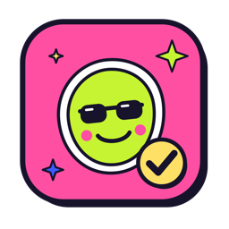
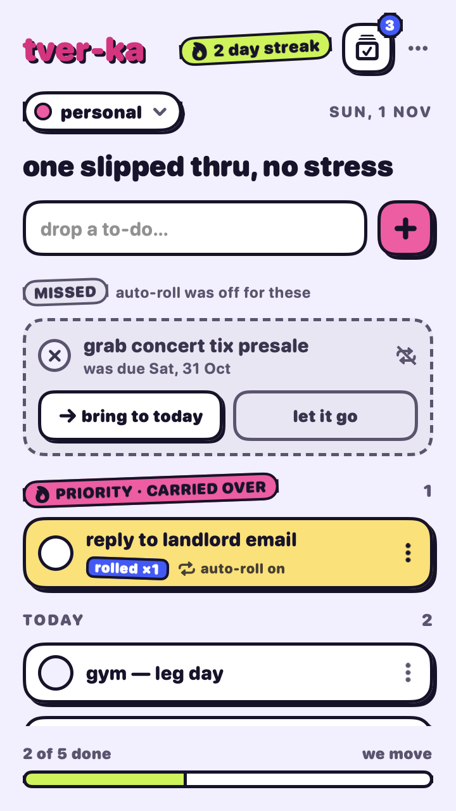
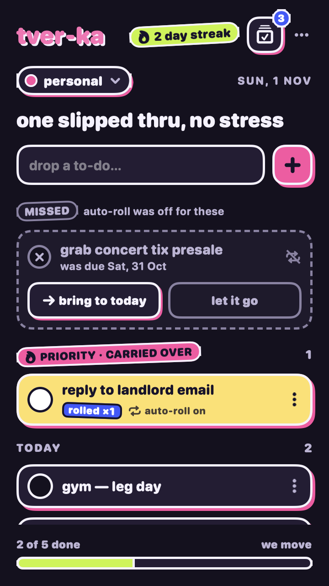
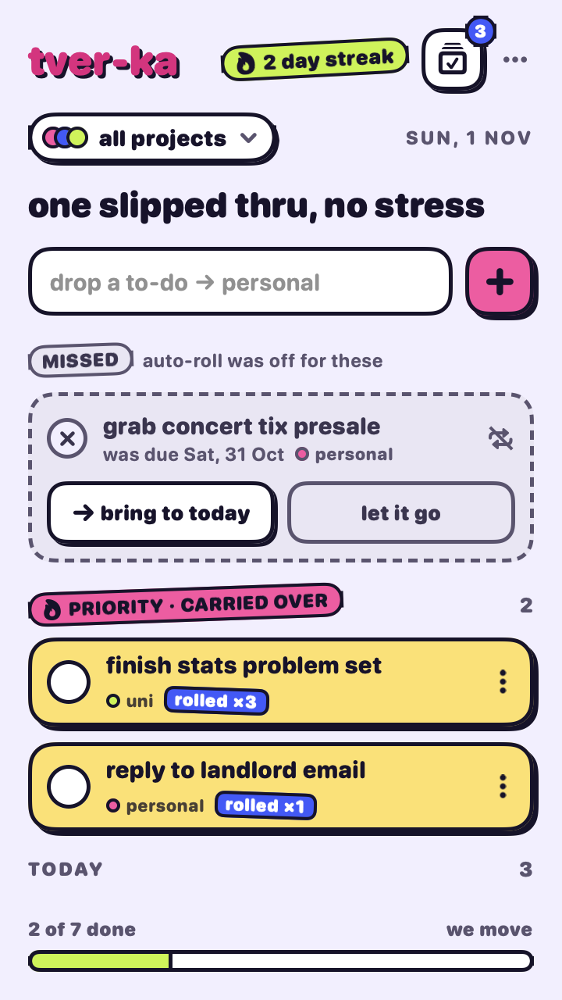
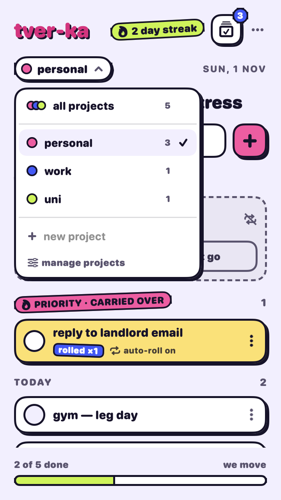
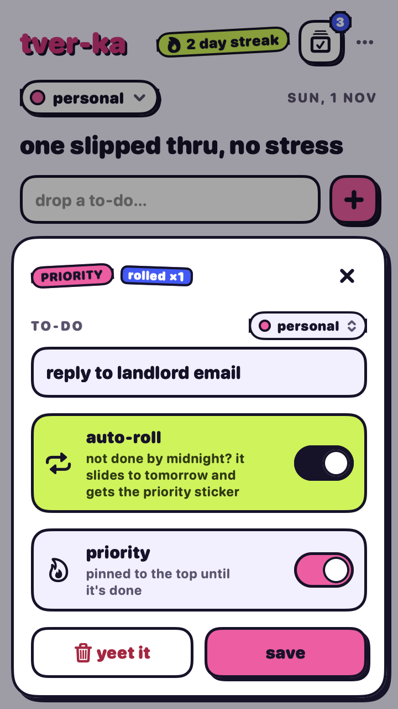
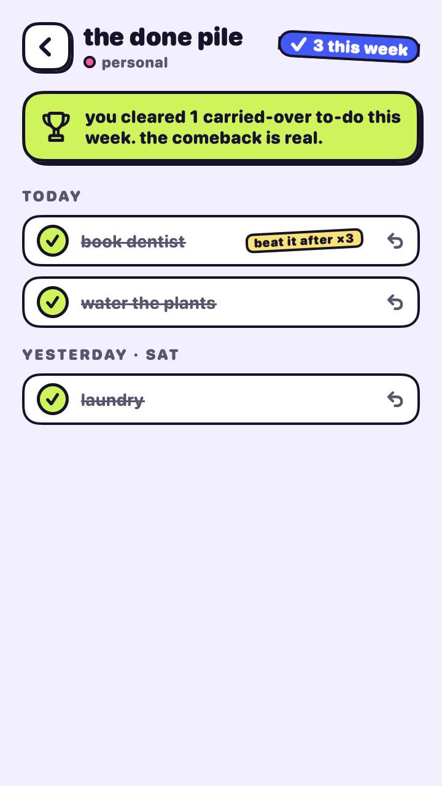
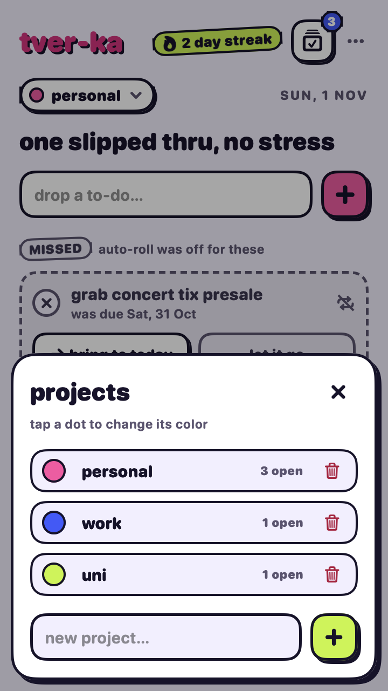
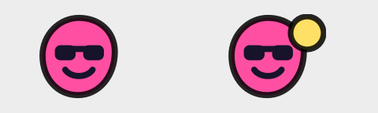

<p align="center">
  
</p>

<h1 align="center">tver-ka</h1>

<p align="center">
  <b>A playful menu bar to-do app for macOS where unfinished tasks don't disappear. They roll over to tomorrow and get louder.</b>
</p>

<p align="center">
  
  
  
  
</p>

<p align="center">
  
  &nbsp;&nbsp;
  
</p>

---

## Why

Most to-do apps let yesterday's unfinished tasks quietly pile up somewhere you never look. tver-ka works differently:

> If a to-do isn't done by midnight, it **slides to the next day** and gets a 🔥 **priority** sticker, with a counter showing how many days it's been carried over (`rolled ×3`).

You can't ignore it, but you can turn it off for any single task. Those tasks stay on their day and show up as **missed**, so you decide to bring them back or let them go.

## Features

- **Auto-roll.** Unfinished to-dos move to today, jump to the top as priority, and count every skipped day, even if your Mac was asleep or the app was closed.
- **Per-task control.** Switch auto-roll off for a to-do and it becomes *missed* instead, with "bring to today" and "let it go" buttons.
- **Projects.** Keep separate lists (work, uni, personal…), each with its own color. Switch with a dropdown, or pick **all projects** to work through everything in one list.
- **The done pile.** Finished to-dos stay out of the way behind one small button, grouped by day, and each one can be undone.
- **Streaks.** The streak counts the days in a row you've finished at least one to-do.
- **Menu bar icon.** A full-color mascot that's easy to spot, with your open count. A yellow dot means priority to-dos are waiting.
- **Light, dark, or match system.**
- **Native and local.** SwiftUI, no account, no network. Your data is a single JSON file on your Mac.

<p align="center">
  
  
  
</p>
<p align="center">
  
  
</p>
<p align="center">
  
  
</p>

## Install

There's no prebuilt download yet, so you build it yourself. It takes about a minute.

**Requirements:** macOS 14 Sonoma or later, plus Xcode 16 or later (or the matching Command Line Tools with Swift 6).

```sh
git clone https://github.com/JBeanny/tver-ka-app.git
cd tver-ka-app
Scripts/bundle.sh --install      # builds and copies tver-ka.app to /Applications
open /Applications/tver-ka.app
```

The app lives only in the menu bar (no Dock icon). Look for the pink blob in sunglasses. If you use a menu bar manager or have a notch, it may start out in the hidden section, so drag it out once.

To start it automatically, open the popover and choose **`…` › Launch at login**.

**Updating:** pull, then run the install again. Your to-dos are stored outside the app, so they carry over.

```sh
git pull && pkill -f TverKa; Scripts/bundle.sh --install && open /Applications/tver-ka.app
```

## How rollover works

| To-do state at midnight | Auto-roll **on** (default) | Auto-roll **off** |
| --- | --- | --- |
| Not done | Moves to today, becomes priority, `rollCount += days skipped` | Stays on its day and shows as **missed** |
| Done | Stays in the done pile | Stays in the done pile |

Rollover runs on launch, when you open the popover, at the calendar day change, after the Mac wakes, and once a minute as a safety net. The rules are a pure function (`Rollover.apply`) and are covered by unit tests, including midnight boundaries and multi-day gaps.

## Your data

Everything is stored in:

```
~/Library/Application Support/tver-ka/todos.json
```

It's plain, readable JSON, so you can back it up, sync it however you like, or inspect it. Nothing leaves your Mac.

## Development

```sh
swift build           # compile
swift test            # run the core test suite
Scripts/bundle.sh     # build build/tver-ka.app without installing
```

Debug settings (set them as environment variables and run the binary directly):

| Variable | Effect |
| --- | --- |
| `TVERKA_DAY_OFFSET=1` | Pretend it's tomorrow, to watch rollover happen |
| `TVERKA_DATA_FILE=/tmp/test.json` | Use a scratch data file instead of your real one |
| `TVERKA_SNAPSHOT_DIR=/tmp/shots` | Render every screen (light and dark) plus the menu bar icon to PNGs, then quit |

```sh
TVERKA_DAY_OFFSET=1 TVERKA_DATA_FILE=/tmp/test.json build/tver-ka.app/Contents/MacOS/TverKa
```

The app icon is drawn in code. After changing it, regenerate `Resources/AppIcon.icns` with:

```sh
swift Scripts/make-icons.swift
```

### Project layout

```
Sources/
  TverKaCore/          # UI-free logic, fully unit-tested
    Todo.swift         #   to-do model and status (today / priority / missed / done)
    Rollover.swift     #   the rollover rules, streak, and done-pile grouping
    Project.swift      #   projects and the on-disk file format
    TodoStore.swift    #   observable store, project scoping, JSON persistence
  TverKa/              # the SwiftUI menu bar app
    TverKaApp.swift    #   MenuBarExtra, day-change and wake watcher
    Views/             #   Today, done pile, task options, projects, theme, icons
Tests/TverKaCoreTests/ # Swift Testing suites
Scripts/
  bundle.sh            # build and wrap into a .app (with --install)
  make-icons.swift     # draws the app icon and writes AppIcon.icns
Resources/AppIcon.icns
```

## Contributing

Issues and pull requests are welcome. Please run `swift test` before opening a PR, and keep the core logic in `TverKaCore` so it stays testable.
